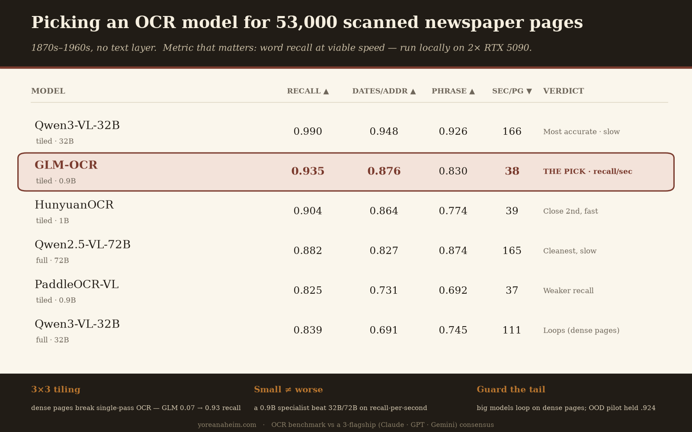

# YoreAnaheim — OCR model evaluation

A small, **practical** benchmark of vision-OCR models for one job: making
**52,897 scanned historical-newspaper pages** (1870s–1960s, image-only, no text
layer) **full-text searchable**, run locally on 2× RTX 5090 for ~$0. It's the
eval harness + data behind [yoreanaheim.com](https://yoreanaheim.com).

The metric that mattered was **word recall at viable throughput and cost** — not
transcription beauty. The winner was a **0.9B specialist (GLM-OCR)** with **3×3
tiling**, not the biggest model.



---

## ⚠️ Read this before citing the numbers

This is a **scrappy, task-specific benchmark, not a definitive OCR leaderboard.**
Its honest limits (all discussed in `docs/BENCHMARK-REPORT.md` and audited in
`docs/review-resolutions.md`):

- **Small n.** A 10-page 1941–49 core sample, plus a 27-page stratified
  out-of-distribution pilot (1872–1964, all four papers). Enough to make a
  production decision; **not** enough to rank models in general.
- **Ground truth is a model *consensus*, not human transcription.** Pages are
  scored against the majority-agreement word multiset of three flagships
  (Claude Opus 4.8, GPT-5.5, Gemini-3.1-Pro; ≥2 of 3 agree). So "recall 0.93"
  means *recall of flagship-legible text* — true page recall is strictly lower,
  and on the densest pages tiled GLM actually **out-read** the flagship
  reference (see the pilot section of the report). One human-transcribed faint
  page is the missing calibration.
- **Domain-specific.** Degraded English-language newsprint, broadsheet layout.
  Conclusions may not transfer to forms, tables, handwriting, or other scripts.
- For a formal, broad benchmark see **OmniDocBench**. This repo is complementary:
  it answers "what should *I* run on *this* corpus, locally, cheaply?"

If you only take one number: GLM-OCR won **recall-per-second / recall-per-dollar**
for search. Qwen2.5-VL-72B and Qwen3-VL-32B (tiled) are more accurate but
3–4× slower.

---

## What's here

```
docs/
  BENCHMARK-REPORT.md            the writeup: method, results, pilot, cost
  adversarial-methodology-review.md   two independent reviews of the method
  review-resolutions.md          every finding from those reviews → fix
scripts/
  benchmark.py     run a sample across all served models → results/summary
  metrics.py       BOW-F1, digit/rare-word recall, phrase adjacency, dict-rate,
                   dehyphenation, max_repeat_run (the degeneration guard)
  triangulate.py   build the 3-flagship consensus truth + score against it
  pilot_report.py  score the out-of-distribution pilot
  search_eval.py   which realistic name/date queries a model's OCR would miss
  scan_corpus.py   corpus inventory (pages, size, decades)
  common.py render.py ocr_client.py   shared: config, page render, OCR client
data/
  summary.json     the leaderboard (per-model aggregate scores)
  triangulate.json the consensus-truth scoring detail
  results.json     per-model, per-page raw OCR output + scores (full repro)
  corpus_scan.json corpus inventory
assets/ocr-model-grid.png
config.example.yaml   model endpoints + the actual OCR prompts + tiling config
```

## Models evaluated

GLM-OCR (0.9B), HunyuanOCR (1B), PaddleOCR-VL base / 1.5 / 1.6 (0.9B),
Qwen2.5-VL-72B, Qwen3-VL-32B (full **and** 3×3-tiled), olmOCR-2 (7B),
dots.ocr (3B), GLM-4.6V-Flash (10B) — plus an embedded-text baseline. Scored
against a **Claude Opus 4.8 / GPT-5.5 / Gemini-3.1-Pro** consensus. Full table
and per-page wins in `docs/BENCHMARK-REPORT.md`.

## Key findings

1. **3×3 tiling is the unlock for dense pages.** Single-pass OCR on a 6–10k-word
   broadsheet collapses for small models (recall 0.07–0.19); tiling fixes it
   (GLM 0.07 → 0.93). Tiling helped *every* small model, not just GLM.
2. **Small ≠ worse for this job.** A 0.9B specialist beat 32B/72B general VLMs on
   recall-per-second, with the lowest failure variance of any fast model.
3. **Every size loops on dense pages.** Full-page decoding hits repetition loops
   at 32B and 72B too — you need a degeneration guard (`max_repeat_run`)
   regardless of model.
4. **The decision was pilot-gated**, not declared from the 10-page sample:
   out-of-distribution recall held (0.924 vs 0.923 baseline) before committing
   to the full corpus.

## Reproduce

The harness expects OpenAI-compatible OCR endpoints (we served them with vLLM in
WSL; see `config.example.yaml` for ports, prompts, and tiling) and the flagship
APIs for the consensus truth.

```bash
cp config.example.yaml config.yaml          # point it at your endpoints/corpus
# Bearer/keys come from the environment, never the config:
export VLLM_API_KEY=...  OPENAI_API_KEY=...  ANTHROPIC_API_KEY=...  GOOGLE_API_KEY=...

python scripts/benchmark.py                  # OCR the sample across served models
python scripts/triangulate.py                # consensus truth + leaderboard
python scripts/pilot_report.py               # score the OOD pilot
python scripts/search_eval.py                # query-miss analysis
```

Source page images aren't redistributed here (they're © their publishers; the
sample is a small research excerpt, and pre-1929 pages are US public domain).
`data/results.json` contains the resulting transcriptions and scores.

## Provenance & license

Part of the **YoreAnaheim** project — a searchable archive of historic Anaheim
and Orange County newspapers ([yoreanaheim.com](https://yoreanaheim.com)).
Benchmark and writeup by **Jon Mabe**, with **Jason Schultz**.

Code: MIT (`LICENSE`). The newspaper page images are **not** included and remain
© their respective publishers; the transcriptions/scores in `data/` are shared
for research/evaluation.
